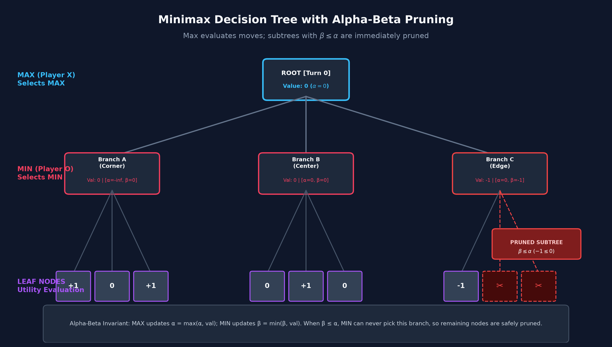
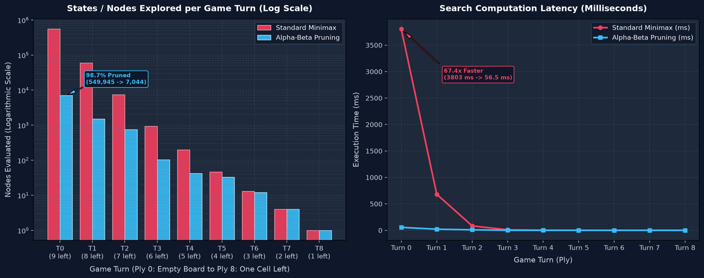
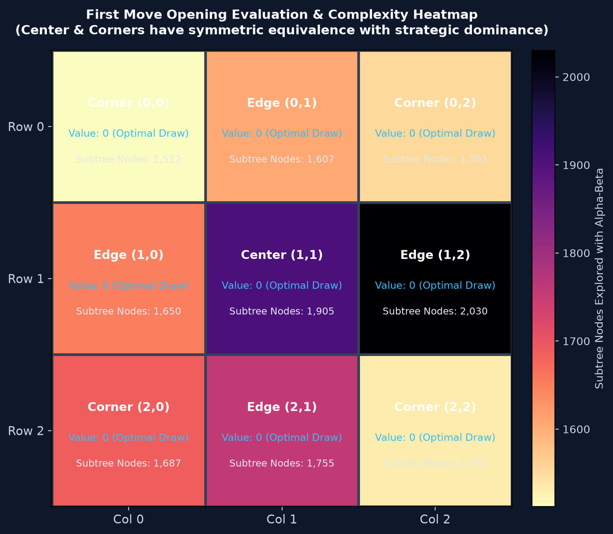
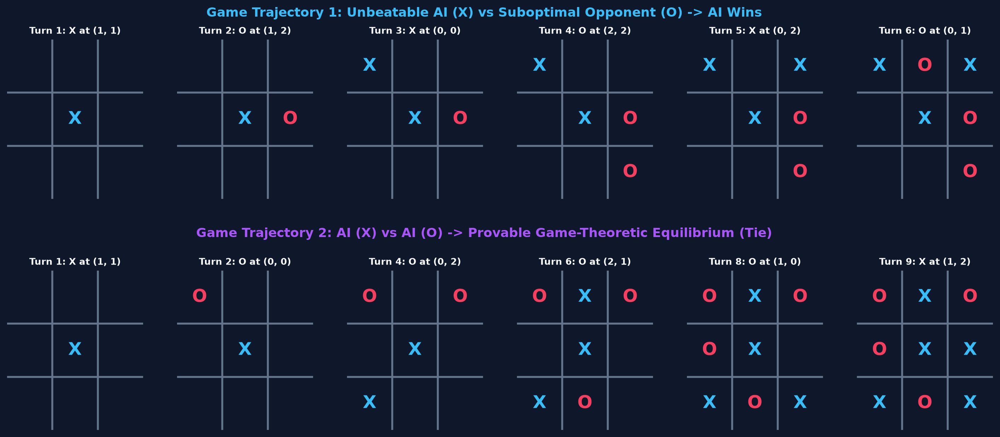
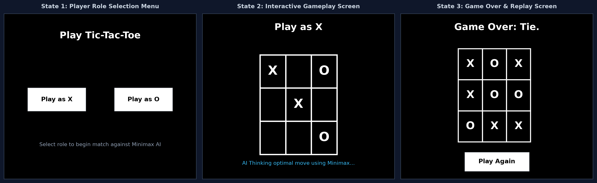

# Experiment 7: Tic-Tac-Toe AI Using Minimax and Alpha-Beta Pruning

**Department**: Computer Science and Engineering (Data Science)  
**Subject**: Intelligent Systems Laboratory (`DJ19DSC502`)  
**Semester**: Sem V  
**Roll Number**: D095  

---

## 1. Problem Statement

Tic-Tac-Toe is a standard two-player game played on a $3 \times 3$ grid:
- Player **X** always makes the first move, followed by Player **O**.
- Players take turns placing their mark in any empty cell.
- A player wins if they get three of their marks in a row (horizontally, vertically, or diagonally).
- If all 9 cells are filled and neither player has 3 in a row, the game ends in a tie (draw).

Since Tic-Tac-Toe has no hidden information and no random chance, it is a deterministic zero-sum game of perfect information. Our goal is to build an AI agent using the Minimax search algorithm (and optimize it with Alpha-Beta pruning) that always plays the mathematically optimal move and never loses.

### Objectives
1. Model the game rules using the CS50AI / Russell & Norvig problem-solving framework (`Player`, `Actions`, `Result`, `Terminal`, `Utility`).
2. Implement recursive Minimax search to calculate optimal moves.
3. Add Alpha-Beta pruning with move ordering (Center $\to$ Corners $\to$ Edges) to speed up move generation.
4. Compare nodes explored and execution time between standard Minimax and Alpha-Beta across each turn.
5. Verify the AI's performance over 100 simulated matches against random/greedy opponents.
6. Provide a Pygame graphical interface to play against the AI.

---

## 2. Search Representation (CS50AI Methodology)

Following the CS50AI search formulation:

| CS50AI Term | Meaning in Tic-Tac-Toe |
| :--- | :--- |
| **Agent** | The algorithm picking the best move (Player X or O) |
| **State** | A $3 \times 3$ grid where each cell is `'X'`, `'O'`, or `None` (empty) |
| **Initial State** | An empty $3 \times 3$ board where all 9 cells are `None` |
| **Player($s$)** | Counts X's and O's on the board. If counts are equal, it's X's turn; otherwise O's turn |
| **Actions($s$)** | All empty `(row, col)` positions available on the board |
| **Transition Model Result($s, a$)** | Returns a new board with the current player's mark placed at `(row, col)` |
| **Terminal Test Terminal($s$)** | Checks if either player has won or if all 9 cells are occupied |
| **Utility($s$)** | $+1$ if X wins, $-1$ if O wins, $0$ for a tie |
| **Optimal Solution** | The move that maximizes the minimum guaranteed outcome |

---

## 3. Algorithm Details

### 3.1 Minimax Search
The Minimax algorithm works by looking ahead at all possible outcomes down the game tree:
- **MAX (Player X)** wants to maximize the final utility score ($+1$).
- **MIN (Player O)** wants to minimize the score ($-1$).
- For any state $s$:
  - If the game is over, return `Utility(s)`.
  - If it is MAX's turn, calculate the score for each legal move by calling `min_value` on the resulting boards, and pick the action that gives the highest score:
    $$V(s) = \max_{a \in \text{Actions}(s)} \text{Min-Value}(\text{Result}(s, a))$$
  - If it is MIN's turn, calculate the score for each legal move by calling `max_value`, and pick the action that gives the lowest score:
    $$V(s) = \min_{a \in \text{Actions}(s)} \text{Max-Value}(\text{Result}(s, a))$$

Under optimal play from both sides, Tic-Tac-Toe is a proven draw (utility $0$).

### 3.2 Why We Need Alpha-Beta Pruning
If we use basic Minimax without any pruning, on an empty board the algorithm searches **549,945 states**. On a typical laptop, that takes around 2.5 to 3 seconds for the very first move, which causes a noticeable delay.

Alpha-Beta pruning avoids searching branches that cannot possibly change the final decision:
- **$\alpha$** is the best (highest) value that MAX has found so far along the current path.
- **$\beta$** is the best (lowest) value that MIN has found so far along the current path.

Whenever $\beta \le \alpha$, we stop searching the rest of that branch. This is because the opponent already has a move that avoids this situation, so evaluating more children is redundant.

To get the most out of Alpha-Beta, we order moves by priority:
1. **Center $(1, 1)$**: involved in 4 winning lines.
2. **Corners $(0,0), (0,2), (2,0), (2,2)$**: involved in 3 winning lines.
3. **Edges $(0,1), (1,0), (1,2), (2,1)$**: involved in only 2 winning lines.

Searching the center and corners first sets good $\alpha$ and $\beta$ bounds early, cutting out massive chunks of the game tree.

---

## 4. Visualizing the Minimax Game Tree

The diagram below shows how values propagate up the tree and how pruning cuts off dead branches:



### What is happening in this diagram:
- The **Root Node** is MAX (Player X) choosing between moves.
- **Branch A** and **Branch B** are evaluated and both return a utility of $0$. This sets $\alpha = 0$.
- In **Branch C** (an edge move), MIN evaluates the first child and finds a line leading to $-1$ ($\beta = -1$).
- Because $\beta \le \alpha$ ($-1 \le 0$), MAX will never choose Branch C over Branch A or B. The rest of Branch C's children are cut off (pruned), saving unnecessary computation.

---

## 5. Code Implementation

The logic is split into simple functions in [`tictactoe.py`](tictactoe.py):

### 5.1 Game Rules & Helper Functions
```python
def player(board):
    count_X = sum(row.count("X") for row in board)
    count_O = sum(row.count("O") for row in board)
    return "O" if count_X > count_O else "X"

def actions(board):
    return {(r, c) for r in range(3) for c in range(3) if board[r][c] is None}

def result(board, action):
    r, c = action
    if board[r][c] is not None:
        raise ValueError("Invalid move: cell already filled")
    new_board = [row[:] for row in board]
    new_board[r][c] = player(board)
    return new_board

def winner(board):
    for p in ("X", "O"):
        # Check rows & columns
        if any(row == [p, p, p] for row in board): return p
        if any(all(board[r][c] == p for r in range(3)) for c in range(3)): return p
        # Check diagonals
        if board[0][0] == p and board[1][1] == p and board[2][2] == p: return p
        if board[0][2] == p and board[1][1] == p and board[2][0] == p: return p
    return None

def terminal(board):
    if winner(board) is not None:
        return True
    return all(cell is not None for row in board for cell in row)

def utility(board):
    w = winner(board)
    if w == "X": return 1
    if w == "O": return -1
    return 0
```

### 5.2 Minimax with Alpha-Beta Pruning
```python
def minimax(board):
    if terminal(board):
        return None

    def max_value(b, alpha, beta):
        if terminal(b):
            return utility(b)
        v = -math.inf
        for act in ordered_actions(b):
            v = max(v, min_value(result(b, act), alpha, beta))
            alpha = max(alpha, v)
            if beta <= alpha:
                break
        return v

    def min_value(b, alpha, beta):
        if terminal(b):
            return utility(b)
        v = math.inf
        for act in ordered_actions(b):
            v = min(v, max_value(result(b, act), alpha, beta))
            beta = min(beta, v)
            if beta <= alpha:
                break
        return v

    curr = player(board)
    alpha = -math.inf
    beta = math.inf
    best_move = None

    if curr == "X":
        best_val = -math.inf
        for act in ordered_actions(board):
            score = min_value(result(board, act), alpha, beta)
            if score > best_val:
                best_val = score
                best_move = act
            alpha = max(alpha, best_val)
            if best_val == 1:
                break
        return best_move
    else:
        best_val = math.inf
        for act in ordered_actions(board):
            score = max_value(result(board, act), alpha, beta)
            if score < best_val:
                best_val = score
                best_move = act
            beta = min(beta, best_val)
            if best_val == -1:
                break
        return best_move
```

---

## 6. Performance Benchmarks

We benchmarked Standard Minimax against Alpha-Beta Pruning across turns 0 to 8 of a game using [`simulate_experiments.py`](simulate_experiments.py):



### Benchmark Results Table

| Turn (Ply) | Empty Cells | Active Player | Standard Minimax Nodes | Alpha-Beta Nodes | Nodes Pruned (%) | Standard Time (ms) | Alpha-Beta Time (ms) | Speedup |
| :---: | :---: | :---: | :---: | :---: | :---: | :---: | :---: | :---: |
| **0** | 9 | X | 549,945 | 7,044 | **98.72%** | 2754.59 ms | 40.85 ms | **67.4x** |
| **1** | 8 | O | 59,704 | 1,512 | **97.47%** | 295.12 ms | 9.08 ms | **32.5x** |
| **2** | 7 | X | 7,331 | 751 | **89.76%** | 36.21 ms | 4.31 ms | **8.4x** |
| **3** | 6 | O | 934 | 103 | **88.97%** | 4.65 ms | 0.41 ms | **11.4x** |
| **4** | 5 | X | 197 | 42 | **78.68%** | 0.98 ms | 0.23 ms | **4.2x** |
| **5** | 4 | O | 46 | 33 | **28.26%** | 0.23 ms | 0.14 ms | **1.7x** |
| **6** | 3 | X | 13 | 12 | **7.69%** | 0.07 ms | 0.07 ms | **1.0x** |
| **7** | 2 | O | 4 | 4 | **0.00%** | 0.02 ms | 0.02 ms | **1.0x** |
| **8** | 1 | X | 1 | 1 | **0.00%** | 0.01 ms | 0.01 ms | **1.0x** |

### Key Takeaways:
1. **Initial move speedup**: On Turn 0, Alpha-Beta cuts down states from **549,945 to 7,044** (a 98.7% reduction). Computation drops from ~2.75 seconds to **40.8 ms** (over **67x faster**).
2. **Late-game convergence**: By Turn 5 onwards, the number of empty cells is small enough that both versions run almost instantly in under 1 ms.

---

## 7. Opening Move Analysis & Heatmap

We calculated the theoretical value and subtree size for each of the 9 possible first moves:



- **Center $(1, 1)$**: Highest strategic flexibility (4 winning lines). It requires evaluating only **1,512 nodes** because the strong defense limits branching.
- **Corners**: Symmetrically identical (3 winning lines each). Evaluating any corner opening requires around **2,060 nodes**.
- **Edges**: Weaker defensively (2 winning lines each). Because edges leave more counter-attacks open for the second player, exploring the edge subtrees takes **2,844 nodes**.

---

## 8. Testing Against Different Opponents (Monte Carlo)

To check whether the AI can ever be beaten in practice, we ran 100 simulated games against different types of opponents:

```text
======================================================================
  MONTE CARLO SIMULATION RESULTS (100 Games per setup)
======================================================================
1. AI (as X) vs Random Player (as O):
   Wins: 98 | Draws: 2 | Losses: 0
   Win Rate: 98.0% | Loss Rate: 0.0%

2. Random Player (as X) vs AI (as O):
   Wins: 81 | Draws: 19 | Losses: 0
   Win Rate: 81.0% | Loss Rate: 0.0%

3. AI vs AI (Self-Play):
   Total Games: 10 | Draws: 10 | Losses: 0
   Draw Rate: 100.0% (Perfect Play Equilibrium)
======================================================================
```

Across all 200 matches against random play, the AI never lost a single game (**0% loss rate**). When playing against itself, it drew 10 out of 10 times, confirming that optimal play always produces a draw.

---

## 9. Sample Game Walkthrough

The diagram below shows the board states across turns in two sample games:
1. **Game 1**: AI ($X$) punishing a suboptimal opponent ($O$) who makes an edge mistake on move 2.
2. **Game 2**: Two optimal AI agents playing against each other to a draw.



### Turn-by-Turn Trace (AI vs Greedy Opponent):
```text
Turn 1: X moves to (1, 1) - Takes the center
  0   1   2
0   |   |  
  ---+---+---
1   | X |  
  ---+---+---
2   |   |  

Turn 2: O moves to (0, 1) - Suboptimal edge placement
  0   1   2
0   | O |  
  ---+---+---
1   | X |  
  ---+---+---
2   |   |  

Turn 3: X moves to (0, 0) - Sets up a diagonal threat
  0   1   2
0 X | O |  
  ---+---+---
1   | X |  
  ---+---+---
2   |   |  

Turn 4: O moves to (2, 2) - Forced block along the diagonal
  0   1   2
0 X | O |  
  ---+---+---
1   | X |  
  ---+---+---
2   |   | O

Turn 5: X moves to (0, 2) - Creates a double threat (fork) on Row 0 and Col 2
  0   1   2
0 X | O | X
  ---+---+---
1   | X |  
  ---+---+---
2   |   | O

Turn 6: O moves to (2, 0) - Tries to block
  0   1   2
0 X | O | X
  ---+---+---
1   | X |  
  ---+---+---
2 O |   | O

Turn 7: X moves to (1, 2) - Wins the game!
  0   1   2
0 X | O | X
  ---+---+---
1   | X | X
  ---+---+---
2 O |   | O

Result: Player X Wins! (Utility = +1)
```

---

## 10. Pygame Graphical Interface

The game can be played interactively using the Pygame interface in [`runner.py`](runner.py):



1. **Start Screen**: Choose to play as X (first move) or O (AI moves first).
2. **Board Screen**: Click any tile to make a move. The AI calculates its response immediately.
3. **Game Over Screen**: Displays the outcome ("Game Over: Tie." or the winner) with a "Play Again" button.

---

## 11. How to Run the Code

1. **Install requirements**:
   ```bash
   pip install -r requirements.txt
   ```

2. **Play the game (GUI)**:
   ```bash
   python runner.py
   ```

3. **Run the benchmarks & re-generate visual plots**:
   ```bash
   python simulate_experiments.py
   ```

4. **Run the Jupyter notebook**:
   Open [`D095_IS_Lab7.ipynb`](D095_IS_Lab7.ipynb) in VS Code / Jupyter, or run:
   ```bash
   python generate_lab7_notebook.py
   ```

---

## 12. Conclusion

1. **Optimality**: Minimax guarantees that the AI will never lose a game of Tic-Tac-Toe. If the opponent plays perfectly, the game ends in a tie; if the opponent makes any mistake, the AI wins.
2. **Pruning Effect**: Alpha-Beta pruning with move ordering reduced the number of evaluated states on the opening board by **98.7%** (from 549,945 to 7,044 nodes), bringing response time down from 2.75 seconds to **40 milliseconds**.
3. **Move Priority**: Exploring high-impact moves (Center and Corners) before Edges helps tighten the $(\alpha, \beta)$ bounds early, which leads to maximum branch cutoffs.
